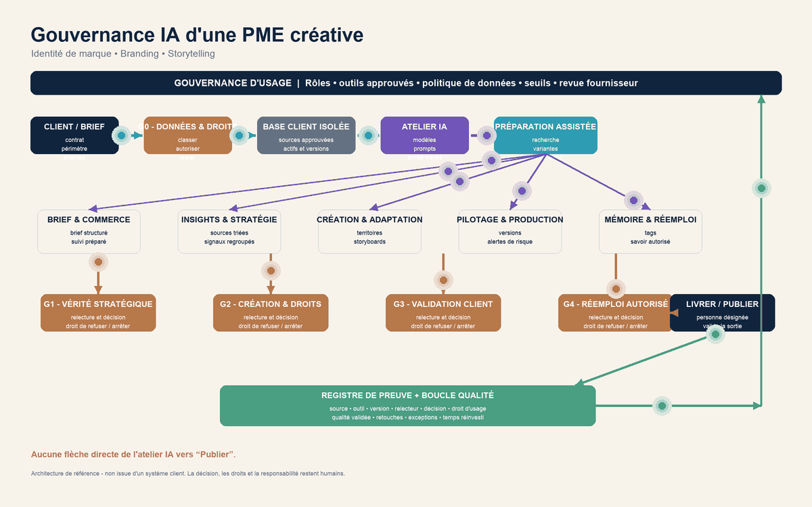

# BrandOps-360

Architecture de référence pour gouverner l’IA appliquée dans une PME créative : identité, branding et storytelling.

BrandOps-360 organise le passage d’une intention créative à un contenu publiable, sans confier la décision à la machine. L’IA peut assister l’exploration, la structuration et la production ; les humains conservent la décision, la responsabilité des droits et la responsabilité de publier.

## Les quatre gates

| Gate | Rôle |
| --- | --- |
| **G1 — Cadrer** | Définir l’intention, les sources autorisées, les droits, l’audience et les contraintes du projet. |
| **G2 — Explorer** | Produire et comparer des pistes créatives sous direction humaine. Chaque sortie reste un brouillon. |
| **G3 — Vérifier** | Contrôler la cohérence avec l’identité, la qualité du récit, les sources et les risques de confusion. |
| **G4 — Autoriser** | Une personne responsable valide la version finale, les droits associés et la publication. |

Le schéma animé du dépôt montre cette progression, les retours possibles entre les gates et les points où une décision humaine est obligatoire.

BrandOps-360 n’est pas un système de publication autonome. Il ne remplace ni l’auteur, ni le responsable éditorial, ni la personne qui porte les droits et la décision finale.

> Le visuel est une architecture conceptuelle : il ne représente ni un système client ni un déploiement en production.

## Contenu du dépôt

- `index.html` — version interactive publiée avec GitHub Pages.
- `02_SCHEMA_GOUVERNANCE_PME_BRANDING.svg` — schéma vectoriel statique.
- `02_SCHEMA_GOUVERNANCE_PME_BRANDING.png` — schéma raster statique.
- `03_SCHEMA_GOUVERNANCE_PME_BRANDING_ANIME.gif` — animation autonome.
- `04_NOTE_GOUVERNANCE_PME_BRANDING.pdf` — note explicative en deux pages.
- `AUDIT_PREUVES_ET_PUBLICATION.md` — périmètre et limites de publication.

## Repères de méthode

Le cadre s’appuie à haut niveau sur le cycle Govern, Map, Measure, Manage du NIST AI RMF et sur les recommandations de la CNIL relatives à l’IA générative. Il ne constitue ni une certification, ni un avis juridique, ni une affirmation de conformité.
